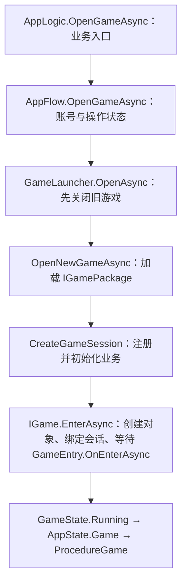
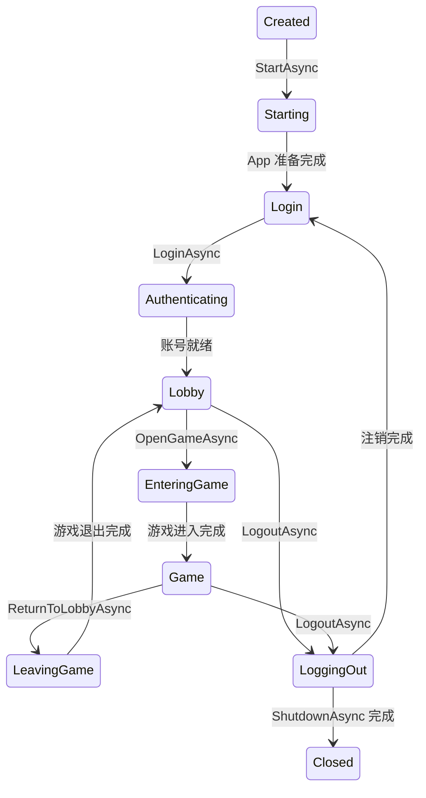

# QFramework：ZFramework 基础与业务架构

这个项目演示：**启动 → 登录 → 大厅 → 游戏 → 注销 → 换账号登录**。

ZFramework.Unity 提供资源、UI、场景和网络等基础能力；QFramework 提供业务规范，Session 管理账号和游戏的使用期间。

## 导入并运行示例

1. 打开 **Window → Package Manager**，选择 **QFramework**。
2. 在 **Samples** 中导入 **SessionDemo**。通常导入到 `Assets/Samples/QFramework/<版本>/SessionDemo`。
3. 打开导入目录下的 **App/App.unity**，按 Play。场景、Prefab、游戏入口与 YooAsset 收集配置均已准备好。
4. Alice 登录 → 打开 A → 玩一局 → 打开 B → 返回大厅 → 注销 → Bob 登录。

示例自带的 `Editor/BundleCollectorSetting.asset` 已配置 app、game-a、game-b 三个包。若移动示例目录，先打开 **YooAsset → Bundle Collector**，点击 **Fix** 修复收集路径，再点击 **Save** 保存；YooAsset 会根据资源 GUID 找到新目录。如果项目已有收集配置，将这三个包合并进项目现有配置，保持项目中只有一份收集配置。

随包示例源文件位于 [Samples~/SessionDemo](Samples~/SessionDemo)，不直接参与项目编译。导入后运行自己的副本，不直接打开包内 Samples~ 场景。

你会看到：换游戏时金币保留、游戏回合重新开始；换账号时账号数据重新建立。示例使用模拟服务器，不会发起真实登录或下注。Alice 初始金币 100，Bob 为 200；游戏 A 每局加 10，游戏 B 每局加 20。

## 第一次只读这三个位置

| 顺序 | 看哪里 | 先看什么 |
| --- | --- | --- |
| 1 | [AppLogic.cs](Samples~/SessionDemo/App/AppLogic.cs) | 文件上半部分的 Start、Login、OpenGame、ReturnToLobby、Logout 五个入口 |
| 2 | [PlayRoundCommand.cs](Samples~/SessionDemo/GameA/PlayRoundCommand.cs) | 一局怎样改变游戏回合和账号金币 |
| 3 | [GameAEntry.cs](Samples~/SessionDemo/GameA/GameAEntry.cs) | 游戏进入时怎样绑定显示、监听金币和加载内容 |

按钮都走同一条路径：**Inspector → AppEntry → AppLogic → 框架**。所有游戏按钮共用 `AppEntry.OpenGame(string)`，Inspector 参数填 `game-a` 或 `game-b`，无需为每个游戏再加按钮方法。

第一次可以跳过 AppEntry 中的异常显示与关闭兜底、AppView 的显示细节、AppProcedures 的流程转接，以及包内加载器实现。它们不是新增游戏时需要复制的代码。

## 想理解框架实现时

按 **QFramework 注册/事件 → Session → GameLauncher → AppFlow → Unity/ZFramework 适配器** 阅读。先看正常进入与退出，再看取消、回滚和重试。

[源码阅读路线](#按调用顺序读源码) 逐项解释相近类型、对象由谁持有、一次登录/进入游戏的调用链、状态变化以及退出顺序。核心方法也按该顺序组织，并在关键等待与清理处说明原因。

## 只记住三种使用期间

| 数据属于谁 | 例子 | 什么时候清理 |
| --- | --- | --- |
| App | 服务器配置、基础组件 | App 关闭 |
| 当前账号 | 身份、钱包、大厅连接 | 注销 |
| 当前游戏 | 回合、游戏服务、资源引用 | 退出游戏 |

Session 就是管理这一段使用期间的容器。游戏获取钱包时，自动找到当前账号的钱包。业务无需手动创建、初始化或销毁 Session。

```text
App 主架构（启动至 App 关闭）
  服务器配置、基础组件访问入口、公共服务
  └─ 账号 Session（登录成功至注销）
       账号信息、Token、钱包、账号缓存、账号级连接与订阅
       └─ 游戏 Session（进入游戏至退出）
            游戏规则、回合状态、本次游戏的资源引用和实例
```

App 常驻不代表登录状态常驻。钱包、Token 等不得注册到 App 根架构；每次登录重新向账号 Session 注册新对象。游戏从账号会话查找服务，账号会话再从 App 查找，因此游戏访问的是当前账号的钱包和同一份基础服务。

普通 `SendEvent / RegisterEvent` 与 QF 一样在整个 App 架构范围内通信。账号发送金币变化，游戏直接监听；游戏退出自动解除游戏订阅，注销解除账号及游戏订阅，App 订阅保留。

Procedure 继续编排项目步骤和界面：示例为 Launch → Login → Lobby → Game。它跟随 AppLogic 的操作结果切换，不在 OnLeave 重复卸载游戏或销毁账号。

事件注册都使用 `this.RegisterEvent<T>(handler)`，框架按使用者自动清理：

| 使用位置 | 在哪里注册 | 自动解除时机 |
| --- | --- | --- |
| 普通游戏组件 / Model / System | 游戏或服务初始化时 | 所属会话结束 |
| SessionUIForm 窗口 | OnOpen，先调用 base | 窗口关闭、销毁或会话结束 |
| AppProcedure 流程 | OnEnter，先调用 base | 离开流程、销毁或所属会话结束 |

窗口复用、流程再次进入时会重新执行 OnOpen / OnEnter，不在只执行一次的 OnInit 中注册业务事件。界面中的属性订阅使用 `Track(wallet.coins.RegisterAndInvoke(ShowCoins))`，同样自动清理。

## 修改现有业务

| 想做什么 | 修改位置 |
| --- | --- |
| 每局奖励 | GameA/PlayRoundCommand.cs |
| 接配置与登录服务器 | App/AppBackend.cs，实现 IAppBackend |
| 账号和钱包结构 | App/DemoApp.cs |
| 登录后注册服务、等待账号数据 | AppLogic.ConfigureAccountAsync、PrepareAccountAsync |
| 展示界面或调整按钮状态 | App/AppView.cs |
| 项目自己的启动 Procedure 步骤 | App/AppProcedures.cs |

资源初始化等待、按需下载、取消、回收由已有适配器处理。真实列表项有房间、渠道等参数时，调用 `AppEntry.OpenGameAsync(id, new GameLaunchData(roomId))`；普通 Inspector 按钮只需填写游戏 ID。

## 照着接入一个 GameC

下面从最少的业务开始：点击一次按钮，游戏分数加 1。它不需要复制 A/B 的资源演示、金币事件或任何生命周期清理代码。

### 1. 建独立程序集与三个脚本

在导入后的 `SessionDemo` 目录中新建 `GameC`，在 Unity 中创建 Assembly Definition，命名为 `Demo.GameC`，引用 `QFramework`、`Demo.App`、`Unity.ugui`。App 的程序集不增加对它的引用。

`GameCDefinition.cs`：只注册本游戏的数据。

```csharp
using QFramework;
using UnityEngine;

namespace Demo.GameC {
    [CreateAssetMenu(menuName = "Session Demo/GameC")]
    public sealed class GameCDefinition : GameDefinition {
        public override void Configure(Session session) {
            session.RegisterModel(new GameModel());
        }
    }
}
```

`GameCLogic.cs`：保存数据并通过 Command 修改。

```csharp
using QFramework;

namespace Demo.GameC {
    public sealed class GameModel : AbstractModel {
        public readonly BindableProperty<int> score = new(0);
        protected override void OnInit() { }
    }
    public sealed class AddScoreCommand : AbstractCommand {
        protected override void OnExecute() {
            this.GetModel<GameModel>().score.Value++;
        }
    }
}
```

`GameCEntry.cs`：只绑定显示和按钮。

```csharp
using System.Threading;
using System.Threading.Tasks;
using QFramework;
using UnityEngine;

namespace Demo.GameC {
    public sealed class GameCEntry : GameEntry {
        [SerializeField] private UnityEngine.UI.Text m_Score;

        protected override Task OnEnterAsync(CancellationToken cancellation) {
            this.GetModel<GameModel>().score
                .RegisterAndInvoke(ShowScore)
                .UnregisterWhenSessionEnds(Session);
            return Task.CompletedTask;
        }
        private void ShowScore(int value) => m_Score.text = $"Score: {value}";
        public void PlayRound() => this.SendCommand(new AddScoreCommand());
    }
}
```

### 2. 配置入口与资源包

- 创建 GameC 根对象，挂 GameCEntry，在其下放 Canvas、Text 和 Button。Text 拖给 m_Score，按钮 OnClick 绑定 GameCEntry.PlayRound。
- 将根对象设为未激活，再保存为 `GameC/Game.prefab`。加载器会先绑定会话、完成 OnEnterAsync，再激活它。
- 用 **Create → Session Demo → GameC** 创建 GameCDefinition，保存为 `GameC/Entry.asset`，Prefab 填 Game.prefab，SceneAddress 留空。
- 在 YooAsset 资源收集配置中新建包 `game-c`、分组 `SessionDemo`，收集 GameC 目录；地址规则用 `AddressByFileName`，打包规则用 `PackDirectory`。

GameB 已演示场景入口：Prefab 留空、SceneAddress 填场景地址。场景与普通资源需要分别打包，业务入口写法相同。

### 3. 加入目录，绑定一个按钮

示例的游戏目录来自 DemoBackend，在 AppBackend.cs 返回的 games 数组中增加一行：

```csharp
new GameInfo { id = "game-c", packageName = "game-c", entryAddress = "Entry" }
```

真实项目由服务器配置返回该行，不需要为每个游戏增加 App 业务分支。

在大厅添加或复制一个游戏按钮，OnClick 绑定 **AppEntry.OpenGame(string)**，字符串填 `game-c`。将按钮加入 AppView 的 GameButtons 数组，使加载、注销时能统一禁用。

**新增游戏到这里就完成了。** 无需修改 AppLogic、Procedure、AppFlow，也无需编写 Session 创建、取消、卸载和订阅清理。

编辑器资源模拟模式可直接运行。构建 Player 前，使用 ZFramework 的资源构建工具或 YooAsset 的 Bundle Builder，为当前目标平台构建 app、game-a、game-b；新增 GameC 后也要构建 game-c，并将资源复制到 StreamingAssets。

要单独构建示例 Player 时，将导入的 App 场景加入 Build Profiles 的场景列表，并设为首个启动场景。

## 接真实项目时再看

当前工程通过 UPM 引用本机 ZFramework 等基础包，其他机器需要安装相同依赖。模拟配置和账号由 DemoBackend 提供，生产接口按项目协议实现 IAppBackend；必要的取消信号继续向下传递。

后续章节依次说明项目结构、源码阅读、接入 API、生命周期、Procedure、UI 和业务项目迁移。可以按需要跳转：

- [源码阅读](#按调用顺序读源码)
- [启动与登录](#启动与登录)
- [Procedure 接入](#与现有-procedure-一起使用)
- [UI 与子组件](#zframework-ui-与子组件)
- [业务项目迁移](#两个业务项目的迁移位置)

## 项目结构

- `Runtime/QFramework.cs`：QF 内核与角色规范。
- `Runtime/Session.cs`：数据与服务的作用范围、共享默认事件以及订阅生命周期。
- `Runtime/AppFlow.cs`：启动、认证、大厅、游戏、注销和关闭流程。
- `Runtime/Games`：游戏入口、游戏切换及游戏资源访问合同。
- `Runtime/Loader/ZFramework`：资源池、按需下载、场景、Procedure、会话 UI 与基础组件访问。
- `Samples~/SessionDemo`：App、GameA、GameB、Editor。通过 Package Manager 导入后运行，源代码与资源一同分发。

QFramework 主程序集不引用 ZFramework。接入程序集 `QFramework.ZFramework` 引用两边；ZFramework 无需反向依赖 QFramework。App 程序集不引用 GameA/GameB，游戏程序集引用 App。

## 按调用顺序读源码

使用入门先看本文前半部分的教程；想理解实现时，按下面顺序读。先读正常路径，再回头读取消、失败与重试，不必从第一行遍历所有加载器。

| 顺序 | 文件与入口 | 这一遍只回答什么 |
| --- | --- | --- |
| 1 | [QFramework.cs](Runtime/QFramework.cs)：IArchitecture、Architecture、IOCContainer、CanRegisterEventExtension | 对象按什么类型注册和取得？命令怎样取得上下文？普通事件发到哪里？ |
| 2 | [Session.cs](Runtime/Session.cs)：RegisterModel/System、Initialize、GetModel/System、RegisterEvent、Dispose | 当前账号/游戏的数据怎样独立存在？为什么还能取得父级服务？谁解除订阅？ |
| 3 | [GameLauncher.cs](Runtime/Games/GameLauncher.cs)：OpenAsync → OpenNewGameAsync → CloseCurrentAsync | 一次游戏按什么顺序进入和退出？哪一步开始持有资源、会话和对象？ |
| 4 | [AppFlow.cs](Runtime/AppFlow.cs)：LoginAsync → PrepareLoginSessionAsync；LogoutAsync → RequestClose | 如何等账号就绪才进入大厅？注销如何停止当前操作并等待清理？ |
| 5 | [UnityGamePackageLoader.cs](Runtime/Games/UnityGamePackageLoader.cs)、[ZFrameworkGamePackageLoader.cs](Runtime/Loader/ZFramework/ZFrameworkGamePackageLoader.cs) | 前面的通用步骤怎样落到 Unity 对象和 ZFramework 资源池上？ |

注册和获取的类型键必须一致。例如注册 `RegisterSystem<INetworkSystem>(new NetworkSystem())`，之后才能用同一个接口 `GetSystem<INetworkSystem>()` 获取。Session 的父级查找只扩大查找范围，不改变这条 QF 规则，也不会把父级对象重新绑定到游戏。

### 这些相似名字分别是什么

| 名称 | 是什么 | 谁创建、谁持有、何时释放 |
| --- | --- | --- |
| GameInfo | 目录记录：选择键、资源包名、入口配置地址 | 项目提供；启动器保留副本。不是游戏对象，也不保存回合。 |
| GameArguments | 本次房间、渠道等参数 | 启动器注册到本次游戏 Session，随会话结束释放引用；不写入配置资产。 |
| GameDefinition | 包内可复用的配置资产，指定入口并注册游戏业务 | 加载器借用，IGamePackage 持有；游戏与会话结束后归还该资产引用。 |
| IGamePackage | 一次加载的持有对象与创建接口 | 加载器创建，启动器调用 Configure、CreateGame、UnloadAsync。它不是 YooAsset.ResourcePackage 本身。 |
| IGame | 一次游戏的运行对象，统一提供 Enter/Exit | IGamePackage 创建，启动器调用。Unity 实现在其中创建/销毁业务根对象。 |
| GameEntry | 根对象上的业务组件，用户在这里写进入/退出逻辑 | Unity 加载器创建并绑定会话，等待 OnEnterAsync 后激活；退出时销毁对象或卸载入口场景。 |
| Session | 本次使用期间的业务对象与订阅容器 | AppFlow 创建账号 Session，GameLauncher 创建游戏 Session；只释放自己和子级，不释放父级。 |

不必为了继承这些接口逐个编写实现。普通新增游戏只写 GameDefinition、GameEntry 和自己的业务代码，其余实现由框架提供。

### 沿着一次登录与进入游戏往下读

```text
AppLogic.LoginAsync
→ AppFlow.LoginAsync：创建候选账号，暂不公开给界面
→ PrepareLoginSessionAsync
    → 项目的认证与注册回调
    → Session.Initialize：先 Model，再 System
    → 项目的账号准备回调：等待必要数据/连接
→ 创建当前账号的 GameLauncher
→ 公开 UserSession，AppState = Lobby
→ Procedure 跟随结果显示大厅
```



`GameLauncher.OpenAsync` 管切换顺序；`OpenNewGameAsync` 管新游戏的正常步骤；`RollbackOpenAsync` 只处理本次进入失败的回滚。关闭旧游戏失败时不会进入新游戏，也不会把旧游戏误当作新游戏的回滚对象。

### 状态不是第二套业务操作

公开方法是“要做什么”，State 是“当前做到哪里”。Procedure 读取稳定状态展示界面，不直接修改 State，也不再执行另一套游戏/账号销毁。



上图只画正常路径。取消、失败和重试单独看这张表：

| 情况 | 结果与下一步 |
| --- | --- |
| App 准备失败 | 回到 Created，可重新 StartAsync。 |
| 认证/账号准备失败，回滚成功 | 回到 Login；没有可用的 UserSession。 |
| 认证或进游戏中注销 | 先取消，再等待当前操作退出或回滚；不立刻释放它还在使用的数据。 |
| 进入游戏失败 | RollbackOpenAsync 清理部分创建的对象；AppFlow 按启动器保留的实际状态恢复到 Lobby、Game 或 GameCloseFailed。 |
| 游戏 Exit 失败 | 保留运行对象、会话和资源持有对象，可再次 ReturnToLobbyAsync / LogoutAsync。 |
| Session.Dispose 报错 | 它已尝试所有本地清理；启动器继续归还资源，并报告错误，不重复执行已完成的会话释放。 |
| 资源 Unload 失败 | 保留未完成的资源持有对象，重试该步骤；已退出的游戏不会重新创建。 |
| 注销或 Shutdown 清理失败 | LogoutFailed，重试原关闭入口；清理完成前不能换账号登录。 |

正常返回和切换不会重叠执行。Logout/Shutdown 是可以先请求取消、再等待当前操作的特殊关闭入口；取消回调出错时仍会继续尝试其他清理。

### 退出时为什么要按这个顺序

```text
AppFlow.RequestClose：先让所有注销调用取得同一个任务，再发出取消
→ 等待当前登录/游戏操作完成或回滚
→ GameLauncher：请求游戏任务停止
→ IGame.ExitAsync：业务 OnExit、对象/场景、UI/实体/声音等表现停止
→ Session.Dispose：本地业务对象及订阅释放
→ IGamePackage.UnloadAsync：归还动态资源与入口引用
→ 项目的账号关闭回调：等待账号连接等清理
→ 账号 Session.Dispose
→ 注销回 Login；Shutdown 回 Closed
```

退出业务仍可能读取游戏配置或账号钱包，所以不能先销毁会话；Model/System 可能持有资源，所以不能先归还配置引用。Unity 的 Destroy 延迟到帧末，因此必须等对象真正消失。入口场景由框架等待卸载，游戏额外加载的场景仍由业务退出回调处理。

普通返回大厅只走游戏部分；App 根架构与基础组件不在这个释放链条中。ShutdownAsync 结束后，再由 App 持有者释放准备器拥有的包和根架构。

### 读取消与订阅代码时记住这几件事

| 源码写法 | 这里的实际用途 |
| --- | --- |
| CancellationToken | 请求停止，不会强行终止底层加载；返回结果后还要检查取消并归还迟到资源。 |
| SemaphoreSlim / m_Gate | 保护一次完整转换不被另一次转换穿插；不代表把 Unity 代码放到后台线程。 |
| TaskCompletionSource / m_CloseTask | 取消回调可能同步再次调用 Logout；先公布共享关闭任务，才能让重入调用等待同一次清理。 |
| try/finally | 成功、取消、失败都会释放操作锁，避免之后所有按钮都被永久挡住。 |
| AggregateException | 同时保留业务失败和清理失败，避免后发生的异常掩盖最初原因。 |
| Session 的两份对象顺序记录 | 注册记录包含未 Init 的凭证；初始化记录按实际顺序反向 Deinit。两者用途不同。 |

订阅的来源与有效期也要分开读：来源始终是 App 根事件系统，Session 保存自己的解除句柄；UI/Procedure 再保存一层显示期句柄。显示期结束或会话结束，任意一端先发生都应停止回调。句柄可重复解除，因此两端清理同一订阅不会影响其他使用者。

[ControllerSubscriptions.cs](Runtime/Loader/ZFramework/ControllerSubscriptions.cs) 中的每条活动标记用于处理“派发已经捕获旧委托，但窗口在前一个回调中关闭并重新打开”的情况。只判断窗口现在是否打开，会错误地执行上一轮的回调；还要判断那一条订阅是否仍有效。

理解这条主线之后，再按需要读资源适配器的细节。不要通过删除取消、回滚和等待来减少行数，这些代码保证注销与换账号时不会遗留旧游戏。

## 启动与登录

`AppFlow` 不规定服务器协议、账号类型或认证方式。应用提供异步回调：

```csharp
var flow = new AppFlow(
    App.Interface,
    user => new GameLauncher(user, gamePackageLoader, gameCatalog),
    user => CloseAccountConnectionsAsync(user));

await flow.StartAsync(async token => {
    // 读取服务器配置，等待 ZFramework 基础组件就绪；不下载所有游戏。
    await PrepareAppAsync(token);
});
// 此时 State == Login，显示登录界面。

await flow.LoginAsync(async (user, token) => {
    var response = await backend.LoginAsync(credentials, token);
    token.ThrowIfCancellationRequested();
    user.RegisterModel(new AccountModel(response));
    user.RegisterModel(new WalletModel(response.coins));
    user.RegisterSystem(new LobbySystem());
}, async (user, token) => {
    // 此时 OnInit 已执行，可以访问已绑定架构的服务与模型。
    await user.GetSystem<LobbySystem>().ConnectAndLoadUserAsync(token);
});
// 连接与必要账号数据全部就绪，State 才变为 Lobby。
```

注册阶段就持有的凭证或连接应实现 IDisposable，或在 closeAccount 中清理；认证中途取消时对象可能尚未 Init，不应只依赖 OnDeinit。

认证回调只负责认证和配置候选会话，不提前切换大厅或保存全局 Token。即使后端忽略取消并迟到返回，AppFlow 也会在发布账号之前再次检查取消。

`StartAsync` 失败后停在 Created，可重试；认证失败清理候选会话后回到 Login。需要等待的账号连接清理放在构造函数的 `closeAccount` 回调，它必须能处理认证中途失败、尚未注册账号数据的情况。清理回调不要复用已经取消的账号 LifetimeToken，也不要再次 await 自身的注销流程。网络登出通知可以尽力发送，但不应因服务器不可达而无限阻止本地注销。

## 大厅、游戏与注销

```csharp
await flow.OpenGameAsync("game-a", new EnterGameData(gameId, roomId, channelId));
await flow.ReturnToLobbyAsync();
await flow.LogoutAsync();
// 现在可以重新登录，也可以换账号。
```

- 同时运行一个游戏，切换游戏先完整关闭前一个。
- 返回大厅只释放游戏，不释放账号数据。
- 注销可打断认证和进入游戏；先取消并等待当前操作，再关闭游戏及资源，执行账号异步清理，最后释放账号 Session。
- 游戏退出失败时保留游戏和账号会话，State 为 LogoutFailed；可以再次 LogoutAsync 重试，清理完成前不允许新登录。
- `GameCloseFailed` 表示普通返回/切换时游戏未关闭，可以 ReturnToLobbyAsync 或注销重试。
- 常规操作不允许并发；注销/Shutdown 是能取消并等待当前操作的特殊入口。
- AppFlow 的状态应驱动登录/大厅界面；按钮调用异步流程，不使用 async void Command 执行整个登录或切换。
- 账号失效、被踢下线也调用同一个 LogoutAsync，避免另外实现一条清理路径。

所有操作在 Unity 主线程执行。业务任务应遵守传入的取消令牌；忽略取消的异步后端返回之前，流程仍需等待，以免留下旧账号任务。

## ZFramework 接入

App 根架构可以注册 `new ZFrameworkServices()`，业务通过 QF 的 Utility 能力访问配置好的基础组件：

```csharp
var web = this.GetUtility<ZFrameworkServices>().Get<WebRequestComponent>();
```

此入口不创建、重绑或销毁基础组件。HTTP 传输等能力可以常驻；身份凭证、账号级 WebSocket 通道、消息订阅与缓存归账号会话，在 closeAccount 中停止并等待。

资源入口改为：

```csharp
// App 持有一份，供游戏加载器复用。只准备用户选择的游戏。
var packages = new ZFrameworkGamePackages(resourceComponent);
var loader = new ZFrameworkGamePackageLoader(resourceComponent, packages: packages);
// 可选：大厅提前下载某个游戏（不创建游戏会话）。
await packages.WaitForReadyAsync(60, token);
await packages.PrepareAsync(selectedGame, token);
// packages.Progress 提供当前游戏、阶段、进度与下载字节数。
```

`GameInfo.id` 是目录中选择游戏的键；`packageName` 指定资源包，留空才使用 id；`entryAddress` 是包内 GameDefinition 地址。服务器 GameId、房间、渠道等业务参数通过 OpenGameAsync 的第二个参数传入，不与资源包名混用。

准备器通过 ZFramework 初始化包、请求版本、加载清单、按需下载，再交给加载器。默认沿用 ResourceComponent.PlayMode；本地/远程混合项目可传入 `game => EPlayMode...` 选择模式。CDN、主备服务器、文件系统仍在 ZFramework 的资源配置中设置。已准备的包在本次 App 运行中复用；重新检查远程版本应在没有游戏使用者的安全时机由项目自己的更新流程处理。

准备器只销毁自己创建的包，外部包必须由其拥有者先准备好。取消时等待在途操作结束后回滚，回滚失败允许重试。关闭 App 时先 `await flow.ShutdownAsync()`，再 `await packages.ShutdownAsync()`，最后释放 App 架构。游戏退出与注销不删除磁盘缓存。若由现有项目全权准备资源，可不传 packages，加载器只借用已就绪的包。

入口使用 `ResourceComponent.LoadAssetAsync<GameDefinition>`，归还使用 `UnloadAsset`。直接 YooAsset 句柄接口会绕过 ZFramework 资源池，不作为本项目的业务加载路径。

## 一个游戏可以加载多个资源

GameEntry 中提供 `GameResources`，绑定当前游戏包与生命周期：

```csharp
protected override async Task OnEnterAsync(CancellationToken token) {
    var config = await GameResources.LoadAsync<TextAsset>("GameConfig", token);
    var enemy = await GameResources.InstantiateAsync("Enemy", transform, token);
}
```

- `LoadAsync` 的每次成功借用都分别记录，重复加载同一对象也分别归还。
- 可以 `GameResources.Release(asset)` 提前归还一次借用。
- `InstantiateAsync` 使用 ZFramework 的自动归还实例化接口；销毁实例后不再次 UnloadAsset。
- 可以 `GameResources.Destroy(instance)` 提前销毁实例，退出时仍等待其真正销毁。
- 关闭时拒绝新加载，取消并等待在途请求，销毁实例；Model/System Deinit 后，归还剩余资源与入口引用。
- 取消后迟到返回的资源或实例会立即归还/销毁，不再交给已关闭的游戏。

游戏入口资源只保存配置，运行数据放 Model。GameDefinition 选择一种入口：

- Prefab：填写 Prefab，SceneAddress 留空。
- 场景：填写 SceneAddress，Prefab 留空，并配置 ZFramework SceneComponent。场景以 Additive 加载，退出时框架等待卸载。

两种入口均要求一个未激活的 GameEntry 根对象；场景内只能有一个 GameEntry。加载器先绑定它与子层级的 SessionBehaviour、等待 OnEnterAsync，再激活入口。Awake 不读取尚未绑定的会话，游戏场景里不放 App/Foundation 或另一个 ProcedureComponent。

游戏入口用 `this.GetUtility<GameArguments>().Get<EnterGameData>()` 取得本次参数；可选参数用 `TryGet<T>()`。游戏的配置/Model/System 在 GameDefinition.Configure 注册，服务的异步进入房间写在 GameEntry.OnEnterAsync。即使同一个游戏再次进入，也创建新会话，以支持更换房间。

## 退出顺序与资源包所有权

```text
取消游戏任务与资源请求
→ 等待游戏 OnExitAsync、销毁游戏根对象
→ 释放游戏包的 UI / 实体 / 声音，等待动态实例销毁
→ 释放散图绑定
→ 释放游戏 Session（Model/System Deinit）
→ 归还动态资源、入口资源
→ 注销时再关闭账号连接并释放账号 Session
```

默认按包清理 UI、实体、声音，仅适用于游戏独占包。共享 UI/声音/图标放 App 公共包；如果多个使用者共享游戏包，可向加载器传入自定义 `closePresentation` 回调，按自己的实例/序列号清理。

框架管理的入口场景会自动卸载；游戏额外加载的其他场景仍由 OnExitAsync 显式等待卸载，不能用全局“卸载所有场景”代替。

退出游戏或注销不会默认销毁资源包。归还资源池引用与真正卸载底层资源是两件事，包缓存由 ZFramework 管理。只有 App 明确拥有且引用已归还的非默认包，才调用 ResourceComponent.DestroyPackageAsync；它会拒绝销毁仍有在途加载或有效资源引用的包。

## Session 的业务约束

- 本地优先解析，未注册时查找父级；父级服务保持原来的上下文。
- 注册完成后调用 Initialize，先初始化 Model，再初始化 System。
- 只注册新建的本地对象，不重复注册父级实例。
- 普通 SendEvent / RegisterEvent 直接使用 App 根架构的同一个事件系统，与 QF 的架构范围事件一致。会话负责自身订阅的生命周期，退出不会清空根架构的事件系统。
- 共享模型的 BindableProperty 订阅用 `UnregisterWhenSessionEnds(session)` 或 `session.Track()` 跟踪。
- ZFramework 的 EventComponent 是另一套独立事件系统，其订阅需要显式绑定生命周期。订阅后可用 `session.Track(new CustomUnregister(() => events.Unsubscribe(id, handler)))` 登记解除动作；账号连接和异步回调也应检查账号 LifetimeToken。
- 初始化失败会清理已尝试初始化的对象；Dispose 在单个清理失败时继续清理其他对象。
- 需要等待的清理写在退出回调中。正常注销通过 AppFlow，不直接 Dispose 账号 Session，以免绕过游戏异步退出。
- QF 角色接口保持原有业务能力约束，不是阻止强制转换或任意全局访问的安全沙箱。

## 事件：与 QF 一样，默认在架构范围内共享

App 根架构持有唯一的业务事件系统，账号和游戏 Session 共用。会话负责数据、服务和订阅的生命周期，不划分事件通信范围。业务只需使用 QF 原有写法：

```csharp
// 账号的 WalletModel 或业务 System 更新金币后发送。
this.SendEvent(new CoinsChanged(newCoins));

// 当前游戏直接监听，无需知道父级、事件来源或传播方向。
this.RegisterEvent<CoinsChanged>(OnCoinsChanged);
```

事件类型定义在 App 公共程序集，游戏可以依赖它，App 不引用具体游戏程序集。默认事件不区分父级、子级或兄弟会话；同一根架构下已注册的监听器都能收到，其他独立根架构不受影响。各会话的 Model/System 服务查找仍保持本地优先、逐级查找父级。

订阅的清理由使用方会话负责：游戏退出解除游戏订阅，注销解除账号及游戏订阅，App 的订阅持续到显式解除或 App 根架构释放。`UnregisterEvent(handler)` 只解除当前会话最后一次匹配的注册，不影响其他会话使用同一处理方法的订阅；返回的 IUnregister 也可以提前解除，重复解除安全。

共享模型的 BindableProperty 仍适合显示持续变化的数据。示例钱包的 SetCoins 同时更新属性并发布 CoinsChanged，大厅订阅属性，游戏用普通 RegisterEvent 监听同一个架构事件。

发送/监听能力仍受 QF 角色接口约束。同步派发沿用 QF 的异常规则；会话已释放后不能再发送或注册。注销会取消在途请求，业务回包在修改模型或发送事件前仍应检查 LifetimeToken，尤其不要让旧请求通过保存的根架构引用发布消息。

## App 关闭

```csharp
await flow.ShutdownAsync();
// 再销毁 App 拥有的非默认资源包、账号外的基础服务。
App.Interface.Deinit();
// 最后才卸载基础组件所在场景或退出。
```

AppFlow 不拥有调用方的根架构和 ZFramework 组件，不会在注销时调用全局 ZFrameworkEntry.Shutdown 或 YooAssets.Destroy。正常场景切换必须先 await 关闭；OnDestroy 只是意外销毁时的兜底，应用被强杀时无法保证异步清理完成。

## 示例基础组件与构建

示例配置 ZFramework 的 Base、ObjectPool、Resource、Event、Fsm、Procedure、Scene；界面使用场景中可见的 uGUI，便于查看按钮绑定。正式项目可启用已有 UI、实体、声音、网络组件，接入层会复用它们。

导入示例后直接打开 App/App.unity 运行。示例等待基础资源初始化的超时可在 AppEntry Inspector 设置，超时会回到可重试的启动状态。场景和资源已随包提供，无需生成。App 常驻包为 app，游戏包为 game-a/game-b。构建资源使用 YooAsset 的 Bundle Builder 或 ZFramework 的 BuildWindow/BuildTools。示例保存 link.xml 以保留资源包中的入口类型；C# 代码热更新仍由项目选择。

## 与现有 Procedure 一起使用

Procedure 与 AppFlow 分工固定：**Procedure 编排项目步骤与界面，AppFlow 拥有账号和游戏的生命周期**。

```text
ProcedureLaunch / Config / Agreement / CheckVersion / InitSdk
    项目原有启动步骤，完成准备后 Flow.State == Login
ProcedureLogin
    用户提交认证 → await Flow.LoginAsync(认证与注册, 账号准备)
ProcedureLobby
    用户选游戏 → await Flow.OpenGameAsync(目录键, 业务参数)
ProcedureGame
    返回大厅 → await Flow.ReturnToLobbyAsync()
任意登录后流程
    注销 / 被踢 → await Flow.LogoutAsync()
```

保留项目自己的启动 Procedure 顺序。配置、协议、版本检查和 SDK 初始化仍按现有顺序执行；在最后一个启动 Procedure 中调用一次 `Flow.StartAsync`，其准备回调完成剩余的基础准备，成功后再进入登录。此前的启动流程可以访问 App 根架构，但不创建账号 Session。不要每个启动 Procedure 都再调用 StartAsync，也不要在准备回调中等待 ProcedureLogin，形成循环等待。

登录、大厅和游戏 Procedure 可继承 `AppProcedure`，实现 Flow 属性，在 OnUpdate 调用 `FollowFlow<ProcedureLogin, ProcedureLobby, ProcedureGame>(owner)`。只有 Login/Lobby/Game 稳定状态触发显示流程切换；加载、注销和失败期间保留当前流程显示进度或重试。示例 AppProcedures.cs 实际注册了四个 Procedure，启动 Procedure 调用 AppEntry.StartApp，所有按钮经 AppLogic 进入 Flow，切换跟随 Flow 结果。新增游戏不用新增 Procedure。

项目已有界面切换时，可在各 Procedure.OnEnter 中打开对应界面。进入游戏期间保留大厅，只有 Flow.Game（游戏 OnEnterAsync 完成）后才隐藏大厅。显示逻辑不应修改 Flow.State。

**OnLeave 不再执行游戏退出、场景卸载或账号 Dispose**，这些工作由 Flow 统一等待。切到另一个 Procedure 不代表要注销。AppProcedure.VisibleToken 仅取消这个显示流程的界面任务，不代表账号或游戏的生命周期；Procedure 在 OnEnter 中通过普通 RegisterEvent 注册的事件，会在 OnLeave / OnDestroy 自动解除。Observe 用于观察无法返回 Task 的框架回调，交互按钮可像示例 Run 一样显示异常和重试入口。

## ZFramework UI 与子组件

游戏/账号界面继承 `SessionUIForm`，用 ZFramework 原有 OpenUIFormAsync 打开，userData 传入 `new SessionUIContext(session, viewData)`。资源包参数继续使用项目的包名；不要再通过静态 GameGlobal.Interface 查架构。

- OnOpen 中通过 GetModel/GetSystem 访问当前会话，ViewData 是业务打开参数。
- 普通 `this.RegisterEvent<T>(handler)` 跟随窗口的打开周期，OnClose / OnDestroy 自动解除；不需要 Listen 或手写解除代码。
- 属性或外部订阅用 `Track(subscription)` 登记，例如 `Track(wallet.coins.RegisterAndInvoke(ShowCoins))`，窗口关闭或会话结束都会解除。
- AppProcedure 同样在 OnEnter 中使用普通 RegisterEvent，OnLeave / OnDestroy 自动解除；再次进入时重新注册。
- 通过 IController / ICanRegisterEvent 调用也遵守相同生命周期；窗口绑定的 SessionBehaviour 子组件注册的事件同样随窗口关闭解除。
- OnInit 只做一次性的控件、引用等初始化；业务事件放 OnOpen / OnEnter，并先调用 base。放错阶段会得到明确提示，不会留下只在第一次打开生效的订阅。
- UI 池复用时重新绑定会话，关闭时清空；子组件继承 SessionBehaviour 并随界面绑定。
- 实例化在游戏根对象之外的业务组件，需要由创建方调用 BindSession；组件不拥有会话，不应自行 Dispose。
- 公共包中的账号界面必须在 closeAccount 中先关闭，再释放账号；游戏独占包的界面由游戏退出路径统一回收。框架不会全局关闭其他业务的窗口。

### UI 和 Procedure 的事件写法

```csharp
// SessionUIForm：每次打开都执行，关闭时自动解除。
protected override void OnOpen(object userData) {
    base.OnOpen(userData);
    this.RegisterEvent<CoinsChanged>(OnCoinsChanged);
}

// AppProcedure：每次进入都执行，离开时自动解除。
protected override void OnEnter(ProcedureOwner owner) {
    base.OnEnter(owner);
    this.RegisterEvent<CoinsChanged>(OnCoinsChanged);
}
```

`UnregisterEvent(handler)` 与返回的 IUnregister 仍可提前解除，只影响当前窗口或 Procedure 自己的注册。同一处理方法在账号、其他窗口或 App 中注册，不会被误删。生命周期方法的重写应调用对应 base；不要绕过 Controller，直接对 GetArchitecture().RegisterEvent 注册界面通知，那样订阅属于会话而不是界面。

## 两个业务项目的迁移位置

| 现有代码 | 接入位置 |
| --- | --- |
| DropBall 的 AppEntry.ConfigureSession | 登录注册回调，注册账号 Model/System |
| DropBall 的 RecreateSessionScope / Super-Ace 的账号重置 | Flow.LogoutAsync，再次登录创建新账号会话 |
| DropBall 的 GameSessionCoordinator / ProcedureGame 加载与清理 | Flow.OpenGameAsync / ReturnToLobbyAsync，删除重复清理路径 |
| Procedure.OnInit / UI.OnInit 中的业务事件订阅 | 移到 OnEnter / OnOpen，使用普通 RegisterEvent，删除对应手工解除代码 |
| GameResourcePreparation / InternalGameItem 中的下载逻辑 | ZFrameworkGamePackages，列表项只触发准备并显示进度 |
| DropBallGameModule / SuperAceGlobal.Init | GameDefinition.Configure，只注册游戏服务 |
| InitService / SuperAceGlobal.Startup | GameEntry.OnEnterAsync，等待房间与配置就绪 |
| SuperAceGlobal.Shutdown / 游戏关闭回调 | GameEntry.OnExitAsync，停止业务、连接与额外场景 |
| AppEntry.LobbyArchitecture.GetSystem | 当前游戏 this.GetSystem，向账号会话查找 |

HTTP/Socket 组件可常驻，账号 Token 与大厅连接放账号服务；游戏 Token 与房间连接放游戏服务。包装旧回调接口时，取消不仅要结束等待，还要阻止迟到回包更新模型。两个真实项目的接口、UI 与游戏逻辑仍需按该映射迁移，本仓库示例没有冒充生产服务器。

新增一个独立游戏的完整最小步骤见本文前面的 GameC 教程。内置 A/B 按钮统一绑定 AppEntry.OpenGame(string)，包准备器负责资源组件等待，不需要复制 App 资源辅助类或增加游戏专用按钮方法。
